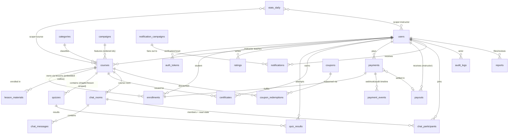

# MONGODB REDESIGN — Mentora Data Layer (Greenfield Proposal v1)

> **Status: PROPOSAL — for owner negotiation.** No code will be written, no collection created, until this document is agreed.
> Rules in force: design is **MongoDB-native only** (no SQL patterns, no ported-SQL thinking), scope is the **DB layer** (collections, schema, indexes, integrity rules, read models), **greenfield** (no data migration), API contracts are **flexible** (frontend follows later), and **all previous workstreams are paused** until this baseline is decided.
> Date: Oct 17, 2026 · Author: AI agent · Evidence: full code trace of 30 current models + 38 services.

---

## 1. Why a redesign — evidence from the current data layer

The current schema is a 1:1 port of the old SQL schema. These are not opinions; each row is a proven defect or conflict found in code:

| # | Defect | Evidence | Consequence |
|---|---|---|---|
| 1 | **Phantom fields = dead features.** Chapter review workflow writes `status`, `submitted_for_review_at`, `reviewed_at`, `reviewed_by`, `rejection_reason` — none exist in `chapter.model.js` | `chapter.service.js:88-91,129-134,172-177` vs `chapter.model.js:4-30` | Chapter submit/approve/reject **can never work**: `chapter.status` is always `undefined`; `approveChapter` always throws "not pending review" (`:121`); `getPendingChapters` always empty (`:193`) |
| 2 | **Unread counts are always 0.** Queries `ChatParticipant.find({ user_id, is_active: true })` and reads `participant.last_read_at` — neither field exists | `chat.service.js:308,315` vs `chatParticipant.model.js:4-26` | Chat unread badge permanently 0; `markChatAsRead` writes nowhere |
| 3 | **Notification scheduling/history drift.** Service creates/reads `title, message, target_audience, recipient_count, delivered_count, failed_count, scheduled_at, sent_at, opened_count` — model has only `notification_id/admin_id/action/status/metadata` | `notification.service.js:185-196,216-241` vs `notificationLog.model.js:4-32` | Scheduled sends, history and metrics are façades over dropped fields |
| 4 | **Audit log drift.** Service writes `action_type/resource_type/resource_id/description/status/before_state/after_state/user_agent` — model defines `action/target_type/target_id/details/ip_address` | `logs.service.js:25-36` vs `auditLog.model.js:4-35` | Compliance trail silently incomplete |
| 5 | **Flawed notification metrics.** Metrics matched by `find({ title, message })` text equality to reconnect notifications to a "log" | `notification.service.js:257-259` | Broken by any duplicate title; unbounded scan |
| 6 | **Payments cannot be audited against Stripe.** No `payment_intent_id`, no charge id, no checkout session, no idempotency key; `amount` is a float | `payment.model.js:22-53` | Webhook fulfillment can't be idempotent or reconciled; float money errors |
| 7 | **Dashboard computation is Node-side scanning.** Active students = load **all** enrollments with `progress` into memory; revenue breakdown does N+1 `findById`/`findOne` per course and per instructor | `adminAnalytics.service.js:67-74`, `analytics.service.js:89-108`, `financial.service.js:63-92` | CPU/memory grows linearly with data; O(users+courses) requests |
| 8 | **Dual profile stores.** Embedded `user.profile` **and** standalone `profiles` collection, kept in sync by hand, plus a capitalized `Profile` compat shim | `auth.service.js:44-59`, `profile.service.js:36-42`, `user.service.js:19-23` | Guaranteed divergence; 3 representations of one fact |
| 9 | **Schema-less payloads.** `Mixed` used for: enrollment progress, quiz questions, quiz answers, learning objectives, AI analysis, report attachments | `enrollment.model.js:26-40`, `quiz.model.js:25-28`, `quizResult.model.js:22-25`, `course.model.js:29-36,127-130` | No validation, no typed queries, silent drift |
| 10 | **Status/enum drift between code and data.** Dashboard counts `Course.countDocuments({ status:"pending" })` but the enum is `pending_review` | `adminAnalytics.service.js:76` vs `course.model.js:108-113` | "Pending reviews" KPI always 0 |
| 11 | **"Featured" exists three times.** `Course.is_featured`, separate `featured_courses` collection, plus `campaigns` | `course.model.js:99-103`, `featuredCourse.model.js`, `campaign.model.js`, `course.service.js:768` | Conflicting sources of truth for homepage |
| 12 | **Category model split.** `categories` + `sub_categories` collections with virtual joins | `category.model.js:48-52`, `subCategory.model.js` | Always read together, needlessly separated |
| 13 | **No maintained counters anywhere.** Enrollment/rating aggregates recomputed by scanning on every dashboard | `analytics.service.js:29-48`, `instructor-stats.service.js:29-45` | Mute switch for scale |
| 14 | **Duplicate/competing indexes.** `Ratings.course_id` declared twice (`index:true` + explicit); `email` unique + index | `Ratings.model.js:20,65`, `user.model.js:37,40` | Wasted writes, index bloat |
| 15 | **`created_at` fields duplicate `timestamps:true`** | `payment.model.js:49-53`, `notification.model.js:56-60`, `ratings.model.js:32-35` | Two "created" truths per doc |
| 16 | **Client-supplied `amount` accepted** into payment records | `payment.controller.js:65` (from auth audit) | Financial records can be forged |
| 17 | **Coupon race.** `used_count/max_count` with read-then-write increments, no per-user redemption record | `coupon.model.js:50-57`, `coupon.service.js` | Over-redemption and unlimited reuse |
| 18 | **Chat read-state/participant semantics missing** beyond #2: no `last_message` on room (room list is N+1 `filter(Boolean)`), no message types/soft-delete, private rooms lack a unique pair key | `chat.service.js:266-292`, `chat_rooms`/`chat_messages` models | Room list heavy, duplicate private rooms possible |
| 19 | **Session/revocation state absent** (`token_version`), tokens stored plaintext, keyed by email only | `user.model.js`, `token.model.js` | Auth-04/AUTH-05 from the auth audit at DB level |
| 20 | **Logs sprawl.** `audit_logs` + `moderation_logs` + `enrollment_logs` + `payment_logs` + `error_logs` + `notification_logs` with overlapping intent, no retention policy except token TTL | `models/admin/*`, `models/payments/paymentLog.model.js` | Six half-trails instead of one compliance trail + domain events |

**What is already good and will be kept:** compound unique indexes on enrollments/ratings/certificates, token TTL index, course text index, `timestamps`, `select:false` on passwords, consistent plural collection naming, UUID `id` exposure pattern (replaced by ObjectId + `id` mapping, see DP-01).

---

## 2. Design principles (the law of this redesign)

1. **Model for access patterns, not for ER-diagram purity.** Every collection exists to serve named queries; every index serves a named query. No speculative structure.
2. **Embed what is bounded and read together; reference what is unbounded or independently queried.** (Course outline embeds; messages, payments, enrollments reference.)
3. **One source of truth per fact.** Denormalization is allowed only when it is *owned* by a named write path (counters, snapshots) and *rebuildable* from the source (rebuild scripts required).
4. **No `Mixed` except for genuinely free-form data** (`settings.value`). Progress, questions, answers, objectives, attachments get real schemas.
5. **Money is integer minor units** (`*_cents: Int`). Never floats.
6. **Money and legal records are append-only**: payments and payment events are never deleted or edited destructively; state transitions only.
7. **Every ref is an ObjectId** (`_id`), one direction only. No bidirectional duplication. (See DP-01.)
8. **Transactions only for cross-collection invariants** (purchase fulfillment, coupon claim + payment, certificate issue). Everything else is single-document atomic.
9. **Counters are updated with atomic operators** (`$inc/$addToSet/$max`) in the same code path that writes the fact — never recomputed by scanning.
10. **Time-series dashboards read rollups** (`stats_daily`), not raw scans. Raw collections serve lists and audit; rollups serve charts.
11. **Retention is a schema decision.** Every log/event collection declares a TTL or archival policy. Financial data is exempt (kept).
12. **Schema-level security**: role/credential fields are only writable by dedicated repo methods; correct answers are only reachable through instructor/admin projection methods; password never selectable except for auth flows.

---

## 3. Domain map & relationships



**Contexts:** Identity (`users`, `auth_tokens`) · Catalog (`courses`, `lesson_materials`, `quizzes`, `categories`, `campaigns`) · Learning (`enrollments`, `quiz_results`, `ratings`, `certificates`) · Commerce (`payments`, `payment_events`, `coupons`, `coupon_redemptions`, `payouts`) · Communication (`chat_rooms`, `chat_participants`, `chat_messages`, `notifications`, `notification_campaigns`) · Ops (`audit_logs`, `error_logs`, `reports`, `settings`) · Analytics (`stats_daily`).

**26 collections** (was 30). Removed: `profiles`, `chapters`, `lessons`, `sub_categories`, `featured_courses`, `notification_logs`, `enrollment_logs`, `moderation_logs`, `payment_logs`. Added: `payment_events`, `coupon_redemptions`, `payouts`, `notification_campaigns`, `stats_daily`.

---

## 4. Collection catalog

Legend: 🔑 unique · 🧭 index · ⏳ TTL. Growth: S/M/L/XL. "Rebuildable" = can be regenerated from sources.

### 4.1 Identity

#### `users`
- **Purpose:** identity, role, status, profile (single source of truth — no `profiles` collection).
- **Shape:**
  ```
  _id: ObjectId
  email: String (lowercase, trimmed)
  password_hash: String            // select:false; bcrypt cost 10+
  role: "student"|"instructor"|"admin"
  status: "active"|"deactivated"|"deleted"
  email_verified_at: Date|null
  profile: {
    first_name, last_name, bio, headline, avatar_url,
    social_links: { twitter?, linkedin?, github?, website?, facebook?, instagram?, youtube? },
    expertise?: [String]           // instructor-specific, optional
  }
  token_version: Int               // bumped on password change/reset/deactivation → kills sessions
  security: { last_login_at, login_fail_count, locked_until }   // account protection (SEC-10)
  stats?: { courses_taught: Int }  // maintained counter (instructor)
  timestamps
  ```
- **Indexes:** `email` 🔑; `{role, status}` 🧭; `{createdAt}` 🧭 (admin growth charts fall back to stats_daily).
- **Invariants:** `role` and `status` are only writable through dedicated repository methods (never mass-assignment from request bodies); `password_hash` never leaves via any DTO; `deleted` users are soft-deleted (`deleted_at` in `status` transition metadata).
- **Growth:** M (bounded to platform users). No TTL.

#### `auth_tokens`
- **Purpose:** email verification, password reset; single-use, hashed, attempt-limited.
- **Shape:**
  ```
  _id: ObjectId
  user_id: ObjectId → users            // user always exists before token (order change vs today)
  purpose: "verify_email"|"reset_password"|"instructor_invite"
  token_hash: String (sha256)          // never plaintext
  attempts: Int                        // max 5 → invalidate
  expires_at: Date                     // verify_email: 24h · reset_password: 30m (DP-08)
  used_at: Date|null
  timestamps
  ```
- **Indexes:** `{user_id, purpose}` 🧭; `token_hash` 🔑 (sparse per purpose); `{expires_at}` ⏳.
- **Invariants:** creating a token of a purpose invalidates previous ones (deleteMany by user+purpose). Verification happens by hashing the presented token and matching.
- **Growth:** S; TTL cleans automatically.

### 4.2 Catalog

#### `courses`
- **Purpose:** course aggregate — metadata, pricing, workflow, **embedded outline (chapters → lessons)**, stats counters, latest AI review.
- **Shape:**
  ```
  _id: ObjectId
  instructor_id: ObjectId → users
  title, subtitle, description          // sanitized rich text
  learning_objectives: [String]         // typed now (was Mixed)
  requirements: [String]
  target_audience: String
  category_id: ObjectId → categories
  subcategory_id: ObjectId              // subdoc id of embedded subcategory
  level: "beginner"|"intermediate"|"advanced"
  pricing: { price_cents: Int, currency: String }
  discount: { enabled: Bool, type: "percentage"|"fixed", value: Int, starts_at?, ends_at? }   // replaces have_discount_* sprawl
  media: {
    thumbnail: { url, public_id },
    intro_video: { url, public_id, hls_url, duration }
  }
  chapters: [
    { _id, title, description, order,
      status: "draft"|"pending_review"|"approved"|"rejected",   // ← workflow now REAL (fixes defect #1)
      submitted_at, reviewed_at, reviewed_by, rejection_reason,
      lessons: [
        { _id, title, order, type: "video"|"text",
          video: { url, public_id, hls_url, duration }|null,
          is_preview: Bool, content: String,            // size-capped (DP-20)
          material_ids: [ObjectId]                      // refs into lesson_materials
        }
      ]
    }
  ]
  status: "draft"|"pending_review"|"approved"|"rejected"|"archived"
  workflow: { submitted_at, reviewed_at, reviewed_by, rejection_reason }
  badge: String                          // display chip ("Bestseller"…)
  ai_review: { status, scores: {...}, feedback, model, reviewed_at }|null   // latest only; history optional later
  stats: {                              // maintained counters — atomic $inc, rebuildable
    enrollment_count: Int, rating_sum: Int, rating_count: Int,
    completion_count: Int, lesson_count: Int
  }
  timestamps
  ```
- **Indexes:** text index `{title, subtitle, description}` (weights 10/5/1); `{status, category_id, pricing.price_cents}` 🧭 (catalog filters); `{instructor_id, createdAt desc}` 🧭; `{status, "stats.enrollment_count" desc}` 🧭 (popular); `{"chapters.lessons._id": 1}` 🧭 (lesson lookup inside embedded outline); `{status, createdAt desc}` 🧭 (admin approval queue).
- **Relations:** category_id → `categories`; instructor_id → `users`; lesson ids referenced by `lesson_materials`, `quizzes`, `enrollments.progress`.
- **Invariants:** outline bounded (≤ 100 lessons recommended, content ≤ 100 KB/lesson — DP-20); `stats` updated only with atomic operators in enrollment/rating/progress write paths; `stats` rebuild script required.
- **Growth:** M; largest docs (outline) but capped.

#### `lesson_materials`
- **Purpose:** downloadable files per lesson (Supabase storage refs).
- **Shape:** `_id, course_id (denormalized for authz), lesson_id, filename, storage: {provider:"supabase", path, public_id, url}, mime_type, size_bytes, order, timestamps`
- **Indexes:** `{lesson_id, order}` 🧭; `{course_id}` 🧭 (access checks without touching the course doc).
- **Growth:** M; no TTL (deleted with course/lesson via service cascade).

#### `quizzes`
- **Purpose:** quiz + typed questions. **Separate collection is a security rule** — answer keys must never travel with course documents.
- **Shape:**
  ```
  _id, course_id, chapter_id, lesson_id|null, title, order, pass_threshold: Int, time_limit_sec: Int|null,
  questions: [{
    _id, type: "single_choice"|"multi_choice"|"true_false",
    text, options: [{ _id, text }],
    correct_option_ids: [ObjectId],        // NEVER serialized to students
    points: Int, explanation: String
  }]
  timestamps
  ```
- **Indexes:** `{course_id, order}` 🧭.
- **Invariants:** student-facing projections are a dedicated repository method (`findForStudent`) that strips `correct_option_ids`/`explanation`; grading runs server-side from the same doc.
- **Growth:** M.

#### `categories`
- **Purpose:** catalog taxonomy — **subcategories embedded** (bounded, always read together).
- **Shape:** `_id, name 🔑, is_featured: Bool, order: Int, subcategories: [{ _id, name, order }], timestamps`
- **Indexes:** `name` 🔑; `{order}` 🧭.
- **Invariants:** deleting a subcategory with courses is blocked by service check (indexed lookup on `courses.subcategory_id`).
- **Growth:** S.

#### `campaigns`
- **Purpose:** marketing banners **and featured-course curation** (single source of "featured").
- **Shape:**
  ```
  _id, kind: "banner"|"featured", title, description, banner_url,
  course_ids: [ObjectId],          // ordered; bounded (≤ 50) — replaces featured_courses collection
  window: { starts_at, ends_at }, is_active: Bool, created_by, timestamps
  ```
- **Indexes:** `{is_active, kind, "window.starts_at", "window.ends_at"}` 🧭 (active campaign lookup).
- **Invariants:** homepage featured = active `featured` campaign → courses by ordered ids (one campaign doc read + one `$in` read). `Course.badge` remains display-only.
- **Growth:** S. **Removed:** `featured_courses`, `Course.is_featured`, `toggleFeatured` duplicates.

### 4.3 Learning

#### `enrollments`
- **Purpose:** the learning fact table — one doc per (student, course) with **typed progress**.
- **Shape:**
  ```
  _id, student_id → users, course_id → courses,
  source: "purchase"|"gift"|"admin"|"free",
  payment_id: ObjectId|null → payments,          // null for free/gift-by-admin
  status: "active"|"completed"|"revoked",
  enrolled_at, completed_at: Date|null,
  progress: {
    completed_lesson_ids: [ObjectId],
    completed_chapter_ids: [ObjectId],
    quiz_scores: [{ quiz_id, best_score, latest_score, attempts: Int }],   // typed (was Mixed)
    completion_percentage: Int,
    last_accessed_at: Date|null,
    current: { chapter_id, lesson_id }|null,
    watch: { total_seconds: Int, by_lesson: Map<ObjectId, Int> }           // typed (was Mixed)
  },
  timestamps
  ```
- **Indexes:** `{student_id, course_id}` 🔑; `{course_id, createdAt desc}` 🧭 (instructor students lists, analytics); `{student_id, "progress.last_accessed_at" desc}` 🧭 (continue-learning); `{course_id, "progress.completion_percentage"}` 🧭 (completion stats).
- **Write invariants:** create enrollment → `courses.stats.enrollment_count $inc 1` + `stats_daily` event + chat participant add — inside the purchase transaction where applicable. `$addToSet` for lesson/chapter completion; watch time via `$inc`.
- **Growth:** L (per-student-course, long-lived; kept).

#### `quiz_results`
- **Purpose:** every attempt, typed answers.
- **Shape:** `_id, quiz_id, course_id (denormalized), student_id, attempt_no, answers: [{question_id, selected_option_ids:[], correct: Bool}], score: Int, passed: Bool, taken_at, timestamps`
- **Indexes:** `{quiz_id, student_id, attempt_no}` 🔑; `{student_id, course_id}` 🧭; `{course_id, taken_at desc}` 🧭 (analytics).
- **Invariants:** all attempts kept (DP-17); `enrollments.progress.quiz_scores` stores best/latest derived values (single writer: submit-quiz service).
- **Growth:** L.

#### `ratings`
- **Purpose:** course reviews (one per student per course).
- **Shape:** `_id, student_id, course_id, rating: Int(1-5), review: String, status: "visible"|"hidden"(moderation), edited_at, timestamps`
- **Indexes:** `{student_id, course_id}` 🔑; `{course_id, createdAt desc}` 🧭; `{course_id, rating}` 🧭 (rating breakdown).
- **Invariants:** create/update/delete → `courses.stats.rating_sum/rating_count` atomic updates (single writer). No `created_at` duplicate (timestamps only).
- **Growth:** L.

#### `certificates`
- **Purpose:** issued proof of completion with public verification.
- **Shape:** `_id, student_id, course_id, serial: String 🔑 (human-verifiable, e.g. MENT-2026-XXXXXX), storage: {path, public_id, download_url}, issued_at, completion_date, verified: Bool, timestamps`
- **Indexes:** `{student_id, course_id}` 🔑; `serial` 🔑 (public verify endpoint needs no scan); `{course_id, issued_at}` 🧭.
- **Invariants:** one per student+course (unique); issued inside transaction with enrollment completion transition.
- **Growth:** L.

### 4.4 Commerce

#### `payments`
- **Purpose:** financial record of a purchase intent/payment. Append-only semantics; never hard-deleted.
- **Shape:**
  ```
  _id, user_id, course_id,
  provider: "stripe",
  provider_refs: {
    payment_intent_id 🔑sparse, checkout_session_id 🔑sparse, charge_id?, invoice_id?
  },
  amount: { subtotal_cents, discount_cents, total_cents, currency },     // integers only
  breakdown: { platform_fee_cents, instructor_earnings_cents, fee_rate_bps },  // snapshot at fulfillment
  coupon: { coupon_id, code, type, value }|null,                          // snapshot, not a join dependency
  status: "created"|"requires_action"|"processing"|"succeeded"|"failed"|"refunded"|"partially_refunded"|"disputed",
  refunds: [{ amount_cents, reason, provider_refund_id, created_at }],    // bounded subdocs
  refunded_total_cents: Int,
  payout_id: ObjectId|null → payouts,     // assigned when settled
  paid_at, failed_at: Date|null,
  timestamps
  ```
- **Indexes:** `{user_id, createdAt desc}` 🧭; `{course_id, createdAt desc}` 🧭; `{status, createdAt desc}` 🧭 (financial lists, trends); `"provider_refs.payment_intent_id"` 🔑 sparse; `"provider_refs.checkout_session_id"` 🔑 sparse; `{payout_id}` 🧭 sparse.
- **Invariants:** `total_cents` is computed server-side from course price + coupon claim — **never from client input** (defect #16); webhook processing looks up by `payment_intent_id`, upserts, and appends events; money fields immutable after `succeeded` except refund fields.
- **Growth:** L; kept forever (financial).

#### `payment_events`
- **Purpose:** append-only provider/webhook/domain timeline for a payment (replaces `payment_logs` sprawl).
- **Shape:** `_id, payment_id|null, provider_event_id 🔑 (idempotency), type, payload: Object (raw, size-capped), status: "received"|"processed"|"failed"|"ignored", error?, received_at, processed_at, timestamps`
- **Indexes:** `provider_event_id` 🔑 (idempotent webhook handling); `{payment_id, received_at}` 🧭; `{status, received_at}` 🧭 (retry queue).
- **Growth:** XL; retention: financial — keep 7 years or archive (DP-15), never TTL-delete before reconciliation.

#### `coupons`
- **Purpose:** discount codes with clear scope and race-free limits.
- **Shape:**
  ```
  _id, code: String 🔑 (uppercase), scope: "global"|"instructor"|"courses",
  course_ids: [ObjectId] (when scope=courses), owner_id: ObjectId|null (instructor),
  discount: { type, value }, window: { starts_at, ends_at }, is_active: Bool,
  limits: { max_uses: Int (0=∞), max_uses_per_user: Int (default 1) },
  stats: { used_count: Int },
  created_by, timestamps
  ```
- **Indexes:** `code` 🔑; `{scope, is_active, "window.ends_at"}` 🧭; `{owner_id}` 🧭.
- **Invariants:** redemption = `findOneAndUpdate({_id, is_active, $or:[{max_uses:0},{"stats.used_count":{$lt:max_uses}}]}, {$inc:{"stats.used_count":1}})` **inside the purchase transaction**; per-user limit enforced by `coupon_redemptions` unique index.
- **Growth:** M.

#### `coupon_redemptions`
- **Purpose:** per-user redemption record — enforces per-user limits and powers coupon analytics.
- **Shape:** `_id, coupon_id, user_id, course_id, payment_id, discount_cents, redeemed_at, timestamps`
- **Indexes:** `{coupon_id, user_id}` 🔑 (per-user limit); `{coupon_id, redeemed_at}` 🧭 (analytics); `{user_id}` 🧭.
- **Growth:** L.

#### `payouts`
- **Purpose:** instructor settlements — replaces "computed on read, always pending" fiction (`financial.service.js:29-30`).
- **Shape:** `_id, instructor_id, period: {start, end}, amount: {gross_cents, platform_fee_cents, net_cents}, payment_count, status: "pending"|"processing"|"paid"|"failed", method?, reference?, processed_at, notes, created_by, timestamps`
- **Indexes:** `{instructor_id, "period.start" desc}` 🧭; `{status, "period.end"}` 🧭.
- **Invariants:** processing a payout = create payout + `payments.updateMany({instructor earnings in period, payout_id:null}, {$set:{payout_id}})` in a transaction → totals derive from assigned payments; voucher/refund after payout = compensation record (never edit closed payouts).
- **Growth:** M.

### 4.5 Communication

#### `chat_rooms`
- **Purpose:** group/private rooms with denormalized last-message for cheap room lists.
- **Shape:** `_id, type: "course"|"group"|"private", course_id|null, name, created_by, participants_key: String|null (sorted user ids for private rooms — unique), last_message: { message_id, sender_id, preview, at }|null, stats: { message_count }, timestamps`
- **Indexes:** `{course_id}` 🔑 sparse (one course room per course); `participants_key` 🔑 sparse (no duplicate private rooms); `{type, updatedAt desc}` 🧭.
- **Growth:** M.

#### `chat_participants`
- **Purpose:** membership **and read state** (the missing fields from defect #2).
- **Shape:** `_id, room_id, user_id, role: "member"|"moderator", joined_at, last_read_at: Date, last_read_message_id: ObjectId|null, unread_count: Int (maintained), muted: Bool, timestamps`
- **Indexes:** `{room_id, user_id}` 🔑; `{user_id, updatedAt desc}` 🧭 (my rooms); `{user_id, unread_count}` 🧭 (badge totals).
- **Write invariants:** on message create → `updateMany({room_id, user_id:{$ne: sender}}, {$inc:{unread_count:1}})` + room `last_message` set (single write path); on mark-read → `unread_count: 0` + `last_read_*`.
- **Growth:** L.

#### `chat_messages`
- **Purpose:** the messages (unbounded → own collection, cursor pagination).
- **Shape:** `_id, room_id, sender_id, type: "text"|"system"|"file", body, attachments: [{url, mime, size}], edited_at|null, deleted_at|null (soft delete), timestamps`
- **Indexes:** `{room_id, _id desc}` 🧭 (cursor pagination — ObjectId ordering replaces createdAt column); `{sender_id, createdAt desc}` 🧭 (moderation).
- **Growth:** XL; retention policy optional (default: keep; course deletion cascades soft-deletes) — DP-12.

#### `notifications`
- **Purpose:** per-recipient inbox item with **embedded per-channel delivery status**.
- **Shape:** `_id, user_id, campaign_id|null, type: enum (course_approved, new_enrollment, certificate_issued, announcement, …), title, body, ref: {type, id}|null, is_read: Bool, read_at|null, channels: { in_app: {delivered_at}, email: {status: "pending"|"sent"|"failed"|"skipped", sent_at, error} }, expires_at, timestamps`
- **Indexes:** `{user_id, is_read, createdAt desc}` 🧭 (inbox + unread); `{user_id, createdAt desc}` 🧭; `{expires_at}` ⏳ (read notifications expire after N days — DP-13).
- **Growth:** XL; TTL keeps it bounded.

#### `notification_campaigns`
- **Purpose:** admin-authored sends — scheduled or immediate, with real metrics (replaces the dropped-field `notification_logs`).
- **Shape:** `_id, admin_id, title, body, type, audience: {kind: "all"|"role"|"course", value?}, channels: {in_app: Bool, email: Bool}, scheduled_at|null, status: "draft"|"scheduled"|"sending"|"sent"|"failed"|"cancelled", stats: {recipients, delivered, failed}, created_at..., timestamps`
- **Indexes:** `{status, scheduled_at}` 🧭 (scheduler poll); `{createdAt desc}` 🧭 (history).
- **Invariants:** read/unread counts per campaign come from `notifications` via `{campaign_id, is_read}` index — no title-matching hacks (defect #5).
- **Growth:** M.

### 4.6 Ops

#### `audit_logs` (unified compliance trail)
- **Purpose:** **one** trail for admin actions, moderation, and security events — replaces `audit_logs` + `moderation_logs` + `enrollment_logs` + notification logs' audit duty.
- **Shape:**
  ```
  _id, category: "admin"|"moderation"|"security"|"system",
  actor_id: ObjectId|null, actor_role, action: String,       // e.g. "course.approve", "user.deactivate", "auth.login_failed"
  target: { type: String, id: ObjectId|null },
  description, before: Object|null, after: Object|null,      // canonical fields (fixes defect #4)
  context: { ip, user_agent, request_id, method, path },
  status: "success"|"failed",
  retention: { expire_at: Date },        // per-category TTL: general 24m, financial 7y
  timestamps
  ```
- **Indexes:** `{actor_id, createdAt desc}` 🧭; `{"target.type": 1, "target.id": 1, createdAt desc}` 🧭; `{category, createdAt desc}` 🧭; `{action, createdAt desc}` 🧭; `retention.expire_at` ⏳.
- **Growth:** XL; TTL via `retention.expire_at`.
- **Security events required** (from auth audit): login success/failure, password reset/change, email verify, role changes, admin status toggles, coupon/payout operations.

#### `error_logs`
- **Shape:** `_id, level, message, stack, context: {request_id, endpoint, method, user_id, ip}, timestamps` · **Indexes:** `{createdAt desc}` 🧭, `{context.request_id}` 🧭 · TTL 90 days (DP-15) · Growth XL.

#### `reports` (abuse/content reports)
- **Shape:** `_id, reporter: {user_id|null, role, is_anonymous}, contact: {email?, phone?}|null (only when anonymous), target: {type: "Course"|"Lesson"|"Quiz"|"User", id}, category, severity, priority, status: "pending"|"in_review"|"resolved"|"dismissed", assigned_to, resolution: {details, resolved_by, resolved_at}, notes: [{author_id, text, created_at}], ai: {category, severity, summary}, timestamps`
- **Indexes:** `{status, priority, createdAt}` 🧭; `{"target.type":1,"target.id":1}` 🧭; `{reporter.user_id}` 🧭.
- **Growth:** L.

#### `settings`
- **Shape:** `_id, key 🔑, value: Mixed (the one legitimate Mixed), data_type, category, is_public, description, updated_by, timestamps` · **Indexes:** `key` 🔑; `{category}` 🧭; `{is_public}` 🧭. Cached in Redis; TTL none. **Growth:** S.

### 4.7 Analytics

#### `stats_daily`
- **Purpose:** pre-aggregated daily metrics powering every chart on admin & instructor dashboards. **This collection is the answer to "how dashboards get their data".**
- **Shape:**
  ```
  _id, date: "YYYY-MM-DD" (UTC, string — sortable, exact-match friendly),
  scope: "platform"|"instructor"|"course", ref_id: ObjectId|null,
  metrics: {
    // daily events (summable over ranges)
    new_users, logins, new_enrollments, completions, new_certificates,
    revenue_gross_cents, discount_cents, refunds_cents, revenue_net_cents, transactions,
    ratings_count, ratings_sum, lessons_completed, quiz_attempts,
    watch_seconds, chat_messages,
    // snapshots (end-of-day state; take latest in range)
    users_total, courses_approved_total, enrollments_total, revenue_lifetime_cents,
    students_total,          // instructor scope: distinct students (computed nightly — not addable)
  },
  generated_at
  ```
- **Indexes:** `{scope, date, ref_id}` 🔑 (one row per day per entity); `{scope, ref_id, date}` 🧭 (range charts per instructor/course); `{scope, date, "metrics.revenue_gross_cents" desc}` 🧭 (top lists).
- **Generation:** nightly Bull repeatable job uses `$merge` upserts (idempotent); **hourly refresh for today's platform/instructor rows**; full rebuild script `npm run stats:rebuild --from --to` (principle #3). Source collections stay authoritative; `stats_daily` is disposable cache.
- **Growth:** bounded (3 scopes × entities × days) — trivially manageable; keep forever.

---

## 5. How the system works on these collections (key flows)

1. **Registration → verification:** create `users` (unverified) → create hashed `auth_tokens(verify_email)` → queue email → verify: hash match, attempt cap, set `email_verified_at`, delete token. (Order fixed vs today: user first.)
2. **Login → session:** verify password → check `status/locked_until` → JWT payload `{sub: user_id, token_version}` → every request compares `token_version` (instant revocation on reset/change/deactivate).
3. **Purchase → enrollment (transaction):** claim coupon (`coupons` atomic $inc) → create `payments(created)` → Stripe intent → webhook: idempotent `payment_events` insert → set payment `succeeded` (+ breakdown snapshot) → create `enrollments` (source=purchase, payment_id) → `$inc courses.stats.enrollment_count` → add `chat_participants` → notification. All multi-doc steps inside one transaction; webhook retries safe.
4. **Free/gift enrollment:** same enrollment path, `payment_id:null`, `source` tagged; gift adds recipient notification; counters updated.
5. **Learning loop:** player reads `enrollments` (+embedded course outline, single document) → lesson complete: `$addToSet` progress + `$inc watch` + recompute percentage in service → course completion triggers certificate issuance (unique index protects double-issue).
6. **Course lifecycle:** instructor edits embedded outline (chapters have real workflow fields now) → `status` transitions with `workflow` timestamps → admin queue via `{status, createdAt}` index → approval sets `stats`/notifications/audit rows.
7. **Chat:** room per course (unique sparse `course_id`) → enrollment upserts participant → message: insert + fan-out `$inc unread_count` + room `last_message` → read: reset `unread_count`. Badge = `$sum` over `{user_id, unread_count}` index — one query.
8. **Notifications:** event → `notifications` doc (in_app immediately, email queued) → worker updates channel status → TTL expires read items. Admin broadcasts: `notification_campaigns` → fan-out job → same docs, metrics by `campaign_id` index.
9. **Moderation/reports:** report → `reports` → admin action → `audit_logs(category=moderation)` + optional content status change (`ratings.status`, course workflow).

---

## 6. Dashboard & analytics read model (the explicit ask)

### 6.1 Strategy tiers (in order of preference)

| Tier | Mechanism | Used for |
|---|---|---|
| 1 | **Entity counters** (`courses.stats`, `users.stats`) | Hot single-entity numbers (course card: enrollments, rating) |
| 2 | **`stats_daily` rollups** | Every time-series chart, trend, period compare, top-N lists |
| 3 | **Indexed queries/aggregations** on source collections | Lists, filters, paginated tables, "today live" numbers |
| 4 | **`$lookup`** | Only in paginated admin lists with bounded page size — **banned in loops** (fixes N+1) |

**Banned by design:** loading full collections into Node to count in JS (`adminAnalytics.service.js:67-74` today); per-row lookups (`financial.service.js:63-92`); matching related data by title text (`notification.service.js:257-259`).

### 6.2 Dashboard-by-dashboard mapping

| Dashboard | Widget | Source | Query strategy |
|---|---|---|---|
| **Admin overview** | totals: users/courses/enrollments | `users`, `courses`, `enrollments` | `countDocuments` with `{role,status}` / `{status}` indexes; or latest `stats_daily` snapshots |
| | revenue today / period / vs previous | `stats_daily` (platform) | range `find` + `$group` — no payment scan |
| | active students 30d | `stats_daily.logins`/watch proxies | sum over range (fixes full-scan) |
| | pending reviews | `courses`, `reports` | `countDocuments({status:"pending_review"})` — enum now real |
| | growth charts | `stats_daily` (platform) | `{scope:"platform", date:{$gte,$lte}}` |
| **Admin financial** | revenue breakdown by course/instructor | `stats_daily` (course/instructor scopes) or `payments` aggregate by `paid_at` | `{scope:"course", date in range}` group by ref_id; join titles via one `$in` batch |
| | transactions table | `payments` | paginated `find({status},{createdAt desc})` + index |
| | payouts | `payouts` + `payments.payout_id` | payout list index; per-payout totals already stored |
| | refunds | `payments.refunded_total_cents` / `payment_events` | indexed aggregates |
| **Platform analytics** | enrollment trend | `stats_daily` (platform/course) | range read |
| | top courses by enrollments/revenue | `stats_daily` (course) | `{scope, date, "metrics.revenue_gross_cents" desc}` → top-N; hydrate titles in one `$in` |
| | user growth / role mix | `stats_daily` + `users` | snapshots + indexed group |
| | course performance (completion, ratings) | `stats_daily` + `courses.stats` | rollups + counters |
| **Instructor dashboard** | my courses + per-course numbers | `courses` (`{instructor_id}`) with `stats` counters | one `find` |
| | earnings & monthly trend | `stats_daily` (instructor) + `payments` paid rows | rollup range; live today from payments `{course_id,$in}` w/ index |
| | students list / recent enrollments | `enrollments` `{course_id, createdAt desc}` | paginated, `$lookup` users limited to page |
| | ratings & reviews | `ratings` `{course_id, createdAt desc}` | paginated |
| | engagement (watch time, completions) | `stats_daily` (course/instructor) | range read |
| **Instructor management (admin)** | instructor list + metrics | `users` + `stats_daily` (instructor) | page users by role; metrics from rollups for the page's ids (one $in) |
| | payouts history | `payouts` | index |
| **Logs explorer** | audit/search | `audit_logs`, `error_logs` | indexed filters; `$text` or anchored regex only (no unanchored scans) |
| **Reports/moderation** | queue + SLA | `reports` | `{status, priority, createdAt}` |

### 6.3 Representative pipelines (design-level)

```js
// Revenue trend, last 30 days (admin) — one indexed range read + group
stats_daily.aggregate([
  { $match: { scope: "platform", date: { $gte: from, $lte: to } } },
  { $group: { _id: null,
      revenue_gross: { $sum: "$metrics.revenue_gross_cents" },
      refunds:       { $sum: "$metrics.refunds_cents" },
      transactions:  { $sum: "$metrics.transactions" } } }
]);

// Instructor earnings by course this month (instructor dashboard)
stats_daily.aggregate([
  { $match: { scope: "course", ref_id: { $in: myCourseIds },
              date: { $gte: monthStart } } },
  { $group: { _id: "$ref_id",
      enrollments: { $sum: "$metrics.new_enrollments" },
      revenue:     { $sum: "$metrics.revenue_gross_cents" } } }
]);

// Top 10 courses by revenue (platform analytics)
stats_daily.aggregate([
  { $match: { scope: "course", date: { $gte: from, $lte: to } } },
  { $group: { _id: "$ref_id", revenue: { $sum: "$metrics.revenue_gross_cents" } } },
  { $sort: { revenue: -1 } }, { $limit: 10 }
]);   // hydrate titles with one courses.find({_id:{$in}}).select("title")
```

### 6.4 Freshness policy

- Entity counters: **immediate** (written with the fact).
- `stats_daily` today-rows: **≤ 1 hour lag** (hourly refresh); yesterday and older: **final after nightly job (~00:30 UTC)**.
- Financial lists (transactions/payouts): **always live** from `payments`/`payouts`.
- Every rollup is rebuildable: `npm run stats:rebuild` must reproduce identical numbers from sources (integrity test included).

---

## 7. Integrity, concurrency, retention

**Transaction map (MongoDB sessions):**

| Flow | Docs touched | Why |
|---|---|---|
| Purchase fulfillment | `payments`, `payment_events`, `enrollments`, `courses.stats`, `coupon_redemptions`, `coupons` | Money ↔ access invariant; coupon claim atomicity |
| Certificate issue | `certificates`, `enrollments.status`, `courses.stats` | One certificate per student+course |
| Payout processing | `payouts`, `payments(payout_id)` | Settlement consistency |
| Role/status change (admin) | `users`, `audit_logs` | Accountability |

**Idempotency:** `payment_events.provider_event_id` 🔑 unique — duplicate webhooks no-op. Course enrollment protected by `{student_id, course_id}` 🔑 — duplicate fulfillment no-ops.

**Atomic counters:** `$inc/$addToSet/$max` only; every counter has a rebuild script; counters are never used for security decisions (paywall = enrollment document existence inside transaction).

**Soft-delete policy:** `users`, `courses`, `chat_messages`, `ratings` use `status/deleted_at` soft delete (content hidden, history intact). Hard delete only via retention jobs on logs and by explicit GDPR-style purge flow (future). Financial documents are never deleted.

**Retention matrix:**

| Collection | Policy |
|---|---|
| `auth_tokens` | TTL `expires_at` |
| `notifications` | TTL `expires_at` (read items expire after N days — DP-13) |
| `audit_logs` | per-doc `retention.expire_at` (general 24m, financial 7y) |
| `error_logs` | TTL 90d |
| `payment_events` | keep/archive 7y (no TTL) |
| `stats_daily` | keep |
| everything else | business lifetime, cascade by middleware on owner deletion |

**Index budget rule:** the index lists in §4 are the complete approved set. No index is added later without a named query and a review; duplicates are prohibited (kills defect #14).

---

## 8. Security-driven schema rules (from the auth audit)

1. `users.role`/`status`/`password_hash`/`token_version` only writable via dedicated repo methods (`setRole`, `setStatus`, `setPassword`) — never mass-assignment; public registration can only ever produce `role:"student"`.
2. `password_hash` has `select:false` **and** the schema `toJSON` transform deletes it unconditionally (defense in depth).
3. `auth_tokens` store sha256 hashes; `attempts` cap; single-use.
4. Quiz `correct_option_ids`/`explanation` only reachable via instructor/admin repository projections; student projection built explicitly (never by deleting keys from a full doc).
5. `reports` minimizes PII: contact fields only for anonymous submissions.
6. `audit_logs` covers every security event listed in §4.6 — the auth audit's "zero auth trail" finding becomes structurally impossible.
7. `payments.amount` is server-computed from course price + coupon claim; the client supplies a course id and coupon code only.

---

## 9. Decision points (owner negotiation — approve/edit before anything is built)

| ID | Decision | Options | Recommendation |
|---|---|---|---|
| **DP-01** | ID strategy | (a) ObjectId everywhere + `id` string in DTOs; (b) keep UUID strings | **(a)** Mongo-native: smaller indexes, built-in time ordering (chat cursor pagination), no uuid dependency; API is flexible so renames are free |
| **DP-02** | Course outline storage | (a) embed chapters → lessons in `courses`; (b) keep separate `chapters`/`lessons` collections | **(a)** outline is bounded and always read whole by the player; **workflow fields become real** (defect #1); guard: lesson count/content size caps |
| **DP-03** | Materials & quizzes | (a) materials separate, quizzes separate; (b) embed both | **(a)**; quizzes **must** be separate for answer secrecy; materials have independent lifecycle/download auth |
| **DP-04** | Taxonomy | (a) embed subcategories in `categories`; (b) keep split collections | **(a)** small, ordered, always read together |
| **DP-05** | "Featured" source of truth | (a) campaigns own ordered `course_ids`; drop `is_featured` + `featured_courses`; (b) keep collection | **(a)** one source; homepage = one campaign read |
| **DP-06** | Profile storage | (a) embedded only, delete `profiles`; (b) standalone only | **(a)**; kill the 3-representation problem at the root |
| **DP-07** | Money representation | (a) integer cents; (b) floats with rounding | **(a)** non-negotiable correctness-wise; add `currency` per payment |
| **DP-08** | Token lifetime | verify_email 24h / reset 30m (copy matches reality), attempts ≤5 | **(a)** as stated — fixes "24 hours" vs 10-min lie |
| **DP-09** | Checkout flow ownership | (a) payments created server-side before intent; webhook authoritative; (b) client-first records | **(a)**; `provider_refs` unique indexes give idempotency |
| **DP-10** | Payouts | (a) real `payouts` + assignment of payments; (b) keep computed estimates | **(a)**; makes financial dashboards deterministic |
| **DP-11** | Coupon limits | (a) atomic claim + per-user redemption docs; (b) counters only | **(a)** |
| **DP-12** | Chat read-state & unread | (a) maintained `unread_count` via fan-out `$inc`; (b) compute-on-read per room | **(a)** at LMS scale (rooms are course-sized); document tradeoff; (b) fallback if rooms become huge |
| **DP-13** | Notification retention | read items TTL 180d / unread keep; campaigns history keep | **(a)** as stated |
| **DP-14** | Unified audit trail | (a) one `audit_logs` w/ categories + per-doc expiry; drop moderation/enrollment logs; (b) keep separate logs | **(a)**; moderation = category, financial retention via `retention.expire_at` |
| **DP-15** | Log retention values | audit general 24m / financial 7y / errors 90d / payment_events 7y | as stated (configurable in `settings`) |
| **DP-16** | Soft vs hard delete | (a) soft for users/courses/messages/ratings; hard only via retention/purge; (b) current hard deletes | **(a)** |
| **DP-17** | Quiz attempts | (a) keep all attempts + best/latest in progress; (b) latest only | **(a)**; analytics + student history need it |
| **DP-18** | Reports PII | (a) reporter ref + contact only if anonymous; (b) keep current free fields | **(a)** privacy-minimal |
| **DP-19** | `stats_daily` scope set & metric list | approve §4.7 list; add/remove metrics | approve list; extend later via `$merge` (no schema break) |
| **DP-20** | Course doc guardrails | lesson cap 100, content cap 100KB, chapters cap 20 (validated) | approve as validation rules |

Budget check: §4 catalog + §6 dashboards + §7 retention answer everything today's 30 collections answer, with 26 collections, 5 new (event log, redemptions, payouts, campaigns, rollups) and 9 deleted.

---

## 10. What this deletes, merges and fixes (one table)

| Today | Becomes |
|---|---|
| `profiles` + embedded + `Profile` shim | embedded `users.profile` only |
| `chapters` + `lessons` (with dead workflow fields) | real embedded outline with working workflow |
| `sub_categories` | embedded in `categories` |
| `featured_courses` + `Course.is_featured` + `toggleFeatured` | `campaigns` |
| `notification_logs` (dropped fields) | `notification_campaigns` (real fields) |
| `enrollment_logs`, `moderation_logs`, `audit_logs` (drifted) | one `audit_logs` (categories + expiry) |
| `payment_logs` (duplicate of payments) | `payment_events` (webhook idempotency + timeline) |
| `Mixed`: progress, questions, answers, objectives, attachments | typed schemas |
| Float `amount`, client-trusted | `*_cents` integers, server-computed |
| Full-scan dashboards, N+1 loops, title-matched metrics | counters + `stats_daily` + indexed queries |
| Duplicate `created_at` fields | `timestamps` only |
| Duplicate indexes | curated index budget |
| `uuid` strings everywhere | ObjectId + `id` DTO mapping (DP-01) |
| No retention anywhere | retention matrix (§7) |
| Unread always 0, chapter workflow never worked, scheduled notifications façade | all three fixed **by schema**, not by patches |

---

## 11. Implementation plan after approval (still no code before then)

1. Freeze this document + decisions → `backend/docs/MONGODB_REDESIGN.md` (agreed).
2. Write the 26 model files (pure schemas + indexes, zero business logic) + shared helpers (money, enums, retention, toJSON/id transform).
3. Index-ensure script + `verify:indexes` check (memory-server) — every §4 index exists, nothing extra.
4. Seed script (demo data covering all 26 collections + one active campaign + stats rows).
5. Repository layer per aggregate (lean reads + explicit DTO mappers; pagination helper).
6. Integration pass with existing test tooling (`smoke:imports`, `verify:migration` adapted); then the paused auth/module workstreams resume **against the new schema** with the security fixes baked in.
